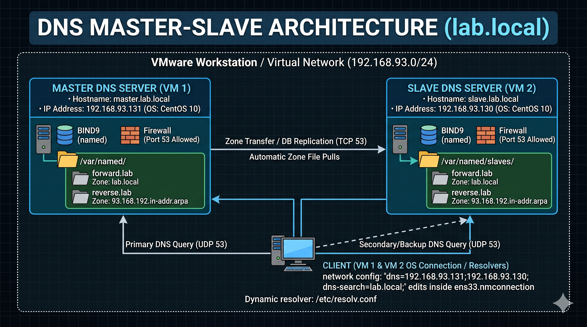

# Complete Beginner's Guide: Configuring a Master-Slave DNS Server

Welcome! This documentation is designed for interns and junior Linux system administrators. Whether you are setting up a lab environment or preparing for an interview, this guide will walk you through everything you need to know about DNS in simple, easy-to-understand words.

---

## 1. DNS Basics & Interview Prep

Before we build the servers, let's cover the foundational concepts you will definitely be asked about in an interview.

### How does DNS resolution work?
Think of **DNS (Domain Name System)** as the phonebook of the internet. Computers talk to each other using numbers called IP addresses, but humans prefer remembering names. Here is step-by-step how a name gets resolved into an IP:
1. **The Request:** You type a website (like `master.lab.local`) into your computer.
2. **Local Cache Check:** Your computer first checks its own memory (cache) to see if it already knows the IP address from a recent visit.
3. **Query the Local DNS:** If it doesn't know, your computer asks its configured DNS server (the one we are building in this lab).
4. **Iterative Search (if needed):** If your local DNS server doesn't have the answer, it acts on your behalf and asks the internet's "Root" servers, then "TLD" servers (like the servers that handle `.com` or `.local`), until it finds the server responsible for that specific name.
5. **The Answer:** The IP address is returned to your computer, and your computer connects to the destination.

### Common Resource Records (What they are and why they are used)
DNS uses different "records" to do different jobs. Here are the most common ones:
* **A Record (Address Record):** Translates a Name into an IPv4 Address. *(Example: `master.lab.local` points to `192.168.93.131`)*.
* **PTR Record (Pointer Record):** The exact opposite of an A record. It translates an IP Address back into a Name. This is used for "Reverse Lookups" to verify if an IP belongs to who it claims to be.
* **CNAME (Canonical Name):** An alias or nickname for another name. If you want `www.lab.local` to go to the exact same place as `master.lab.local` without typing the IP twice, you use a CNAME.
* **MX Record (Mail Exchange):** Tells emails where to go. If you send an email to `admin@lab.local`, the MX record tells the internet which specific server handles emails for the `lab.local` domain. 
* **NS Record (Name Server):** Delegates authority. This record tells the world, "Hey, these specific servers are the ones in charge of holding the DNS records for my domain."
* **SOA Record (Start of Authority):** The very first record in any zone file. It acts as the "ID card" for the domain. It lists the primary master server, the administrator's email, and the rules for how Slave servers should sync data.

### Zone File Parameters Information (What is $TTL, Serial, etc.?)
When you look inside a DNS zone file, you will see some strange variables. Here is what they mean in simple terms:
* **`$TTL` (Time To Live):** How long (in seconds) other servers are allowed to "cache" or remember this DNS data before they have to ask you for an update. (e.g., `86400` seconds = 1 day).
* **`Serial`:** The version number of the file. **You must increase this number every single time you edit the file.** If you don't increase it, the Slave server will think nothing changed and will refuse to download your updates. A standard format is `YYYYMMDD01`.
* **`Refresh`:** How often the Slave server should check with the Master server to see if the Serial number has changed.
* **`Retry`:** If the Master server is down when the Slave tries to refresh, this is how long the Slave waits before trying again.
* **`Expire`:** If the Master server stays down for this long, the Slave server will stop answering queries completely because it assumes its data is too old to be trusted.
* **`Minimum TTL`:** If someone asks for a record that *does not exist*, this is how long they should cache the "Error: Not Found" message.

---


## Architecture Diagram



---


## 2. Lab Details & IP Address Warning

**CRITICAL NOTE FOR YOUR LAB:** The IP addresses used in this guide (`192.168.93.131` and `192.168.93.130`) are just examples. **Your IP addresses will be different depending on your VMware or VirtualBox setup.** 
Before starting, run the `ip a` command on your virtual machines to find your actual IPs. **You must replace my example IPs with your real IPs in every single step below!**

**In this specific lab, we are using:**
*   **Domain Name:** `lab.local`
*   **Master Server IP Example:** `192.168.93.131` *(Change to yours!)*
*   **Slave Server IP Example:** `192.168.93.130` *(Change to yours!)*
*   **Forward Zone File Name:** `forward.lab`
*   **Reverse Zone File Name:** `reverse.lab`
*   **Reverse Network Name:** `93.168.192.in-addr.arpa` *(This is your subnet written backward. If your subnet is `192.168.50.0`, your reverse name is `50.168.192.in-addr.arpa`)*

---

## Phase 1: Configuring the Master DNS Server

The Master server is the main boss. It holds the original copy of the DNS records. We will do this configuration on your first virtual machine.

### Step 1.1: Install BIND
BIND (Berkeley Internet Name Domain) is the software that makes a Linux machine act as a DNS server.
```bash
sudo dnf install bind bind-utils -y
```

### Step 1.2: Edit `/etc/named.conf`
*   **What is this file?** This is the main brain of your DNS server. It tells the DNS software which IPs to listen on, who is allowed to ask for translations, and where the specific zone files are stored.
*   **Why are we adding this?** We need to tell the server its own IP, allow your local network to use it, and tell it about your Master and Slave relationship.

```bash
sudo vi /etc/named.conf
```
Update the top `options` section. **(Remember to change the IPs to match your Master IP, your Subnet, and your Slave IP!)**:
```text
options {
    # CHANGE 192.168.93.131 to YOUR Master IP!
    listen-on port 53 { 127.0.0.1; 192.168.93.131; }; 
    listen-on-v6 port 53 { ::1; };
    directory       "/var/named";
    
    # CHANGE 192.168.93.0/24 to YOUR Subnet!
    allow-query     { localhost; 192.168.93.0/24; }; 
    
    # CHANGE 192.168.93.130 to YOUR Slave IP!
    allow-transfer  { 192.168.93.130; };              
```
Scroll to the very bottom of the file and add your zones. This tells the server the names of the files that hold the actual records:
```text
zone "lab.local" IN {
    type master;
    file "forward.lab";
    allow-update { none; };
};

# CHANGE the 93.168.192 part if your network is different!
zone "93.168.192.in-addr.arpa" IN {
    type master;
    file "reverse.lab";
    allow-update { none; };
};
```

### Step 1.3: Create the Forward Zone File
*   **What is this file?** It holds the "Name -> IP" (A Records). 
*   **Why are we adding this?** So when a computer asks "Who is master.lab.local?", the server can check this list and give the IP address.

```bash
sudo vi /var/named/forward.lab
```
Add the following content. **(Change the IPs at the bottom to YOUR Master and Slave IPs!)**:
```text
$TTL 86400
@   IN  SOA     master.lab.local. admin.lab.local. (
                2026110301 ; Serial (Today's date + 01. Update this number if you edit the file later!)
                3600       ; Refresh
                1800       ; Retry
                604800     ; Expire
                86400 )    ; Minimum TTL

@       IN  NS      master.lab.local.
@       IN  NS      slave.lab.local.
master  IN  A       192.168.93.131  # CHANGE to YOUR Master IP!
slave   IN  A       192.168.93.130  # CHANGE to YOUR Slave IP!
```

### Step 1.4: Create the Reverse Zone File
*   **What is this file?** It holds the "IP -> Name" (PTR Records).
*   **Why are we adding this?** Some security systems need to check if an IP address legitimately belongs to a known hostname.

```bash
sudo vi /var/named/reverse.lab
```
Add the following content. **(The "131" and "130" are the last parts of YOUR IP addresses. Change them to match yours!)**:
```text
$TTL 86400
@   IN  SOA     master.lab.local. admin.lab.local. (
                2026110301 ; Serial
                3600       ; Refresh
                1800       ; Retry
                604800     ; Expire
                86400 )    ; Minimum TTL

@       IN  NS      master.lab.local.
@       IN  NS      slave.lab.local.
131     IN  PTR     master.lab.local.  # CHANGE '131' to the last digits of YOUR Master IP!
130     IN  PTR     slave.lab.local.   # CHANGE '130' to the last digits of YOUR Slave IP!
```

### Step 1.5: Permissions, Ownership, and SELinux
Linux is strict about security. If the DNS service (which runs as a user named `named`) does not have permission to read the files you just created, it will fail.
*   `chown root:named` changes the group ownership to the DNS service.
*   `restorecon` tells SELinux (the built-in security guard in CentOS) to apply the correct security labels to these new files.

```bash
sudo chown root:named /var/named/forward.lab
sudo chown root:named /var/named/reverse.lab
sudo restorecon -Rv /var/named
```

### Step 1.6: Test Syntax Errors
Before starting the server, you must check if you made any typos.
```bash
sudo named-checkconf
sudo named-checkzone lab.local /var/named/forward.lab
sudo named-checkzone 93.168.192.in-addr.arpa /var/named/reverse.lab  # CHANGE network if yours is different!
```
*If everything is correct, `named-checkconf` shows nothing, and the other two say `OK`.*

### Step 1.7: Start Service and Firewalld
We need to turn the server on and open a hole in the firewall so other computers can reach it.
```bash
sudo systemctl enable --now named
sudo firewall-cmd --add-service=dns --permanent
sudo firewall-cmd --reload
```

---

## Phase 2: Configuring the Slave DNS Server

The Slave server is a backup. If the Master goes down, the Slave keeps answering questions. You will do this on your second virtual machine.

### Step 2.1: Install BIND
```bash
sudo dnf install bind bind-utils -y
```

### Step 2.2: Edit `/etc/named.conf`
*   **What is this file?** Same as the Master, but we configure it to pull information from the Master instead of creating it manually.
*   **Why are we adding this?** We tell it to be a "slave" and point it to the Master's IP. It will automatically download the zone files!

```bash
sudo vi /etc/named.conf
```
Update the top block **(Change to YOUR Slave IP and YOUR Subnet!)**:
```text
options {
    # CHANGE 192.168.93.130 to YOUR Slave IP!
    listen-on port 53 { 127.0.0.1; 192.168.93.130; }; 
    listen-on-v6 port 53 { ::1; };
    directory       "/var/named";
    
    # CHANGE 192.168.93.0/24 to YOUR Subnet!
    allow-query     { localhost; 192.168.93.0/24; }; 
```
Scroll to the bottom and add the zones **(Change the Master IP to YOUR Master IP!)**:
```text
zone "lab.local" IN {
    type slave;
    file "slaves/forward.lab";
    masters { 192.168.93.131; }; # CHANGE to YOUR Master IP!
};

# CHANGE the network name if yours is different!
zone "93.168.192.in-addr.arpa" IN {
    type slave;
    file "slaves/reverse.lab";
    masters { 192.168.93.131; }; # CHANGE to YOUR Master IP!
};
```

### Step 2.3: Start Service and Firewalld
```bash
sudo systemctl enable --now named
sudo firewall-cmd --add-service=dns --permanent
sudo firewall-cmd --reload
```
*Note: You don't create zone files here. Go to `/var/named/slaves/` and type `ls`. You will see they downloaded automatically!*

---

## Phase 3: Client Network Configuration

Even though the DNS servers are running, your VMs won't use them unless you tell their Network Interface Cards (NICs) to do so. We edit the network connection file for this. (Do this on both VMs).

### Step 3.1: Edit Network Configuration
*   **What is this file?** The NetworkManager configuration file for your network card (e.g., `ens33` or `ens160`).
*   **Why are we adding this?** We are telling your operating system, "Stop using the default internet DNS. Use my new custom Master and Slave servers instead."

```bash
# Note: Your interface might be ens160 or eth0 instead of ens33. Use 'ip a' to check!
sudo vi /etc/NetworkManager/system-connections/ens33.nmconnection
```
Under the `[ipv4]` section, add these lines **(Change to YOUR Master and Slave IPs!)**:
```ini
[ipv4]
dns=192.168.93.131;192.168.93.130;  # CHANGE to YOUR IPs, separated by a semicolon!
dns-search=lab.local;
```

### Step 3.2: Restart Network & Check `resolv.conf`
```bash
sudo systemctl restart NetworkManager
```
*   **What is `/etc/resolv.conf`?** This is a read-only file generated by the system. It shows you the *active* DNS servers the machine is currently using.
*   **Why check it?** To prove that our edits to the network file actually worked.

```bash
cat /etc/resolv.conf
```
You should see:
```text
search lab.local
nameserver 192.168.93.131  # Should be YOUR Master IP
nameserver 192.168.93.130  # Should be YOUR Slave IP
```

---

## Phase 4: How to Test Your Lab is Working Correctly

If everything is perfect, you can run these simple commands to prove your DNS is working. 

**Test 1: Forward Lookup (Testing the A Records)**
Ping the short names. Because we added `dns-search=lab.local`, the system automatically adds `.lab.local` to the end.
```bash
ping -c 2 master
ping -c 2 slave
```
*Success looks like:* It replies with the correct IP addresses.

**Test 2: Reverse Lookup (Testing the PTR Records)**
Use the `dig -x` command to ask your DNS server what name belongs to an IP. **(Change to YOUR IPs!)**
```bash
dig -x 192.168.93.131
dig -x 192.168.93.130
```
*Success looks like:* Look for the "ANSWER SECTION" in the output. It should say `PTR master.lab.local.` and `PTR slave.lab.local.`

---

## Phase 5: Important DNS Interview Questions & Answers

If you put DNS on your resume, expect these questions in an interview:

**Q: What port does DNS use?**
**A:** DNS primarily uses **UDP Port 53** for standard client queries (like translating a name to an IP). It uses **TCP Port 53** for Zone Transfers (when the Slave server downloads the full records from the Master) or if a query response is too large for a single UDP packet.

**Q: What happens if you forget to change the Serial Number in a zone file?**
**A:** The Slave server will look at the Master server's serial number. Because the number hasn't increased, the Slave will think no changes were made. The Slave will refuse to update its files, meaning your DNS architecture will become out of sync.

**Q: What is the difference between a Forward Lookup and a Reverse Lookup?**
**A:** A Forward Lookup is asking for an IP address when you only have the Name (Uses A records). A Reverse Lookup is asking for a Name when you only have the IP address (Uses PTR records).

**Q: What is a Zone Transfer?**
**A:** It is the automated process where a Slave DNS server copies the zone database files from the Master DNS server so they stay synchronized.

**Q: In your `/etc/resolv.conf`, what does `search lab.local` do?**
**A:** It automatically appends the domain name to short queries. If a user just types `ping master`, the system automatically turns it into `ping master.lab.local` behind the scenes.
